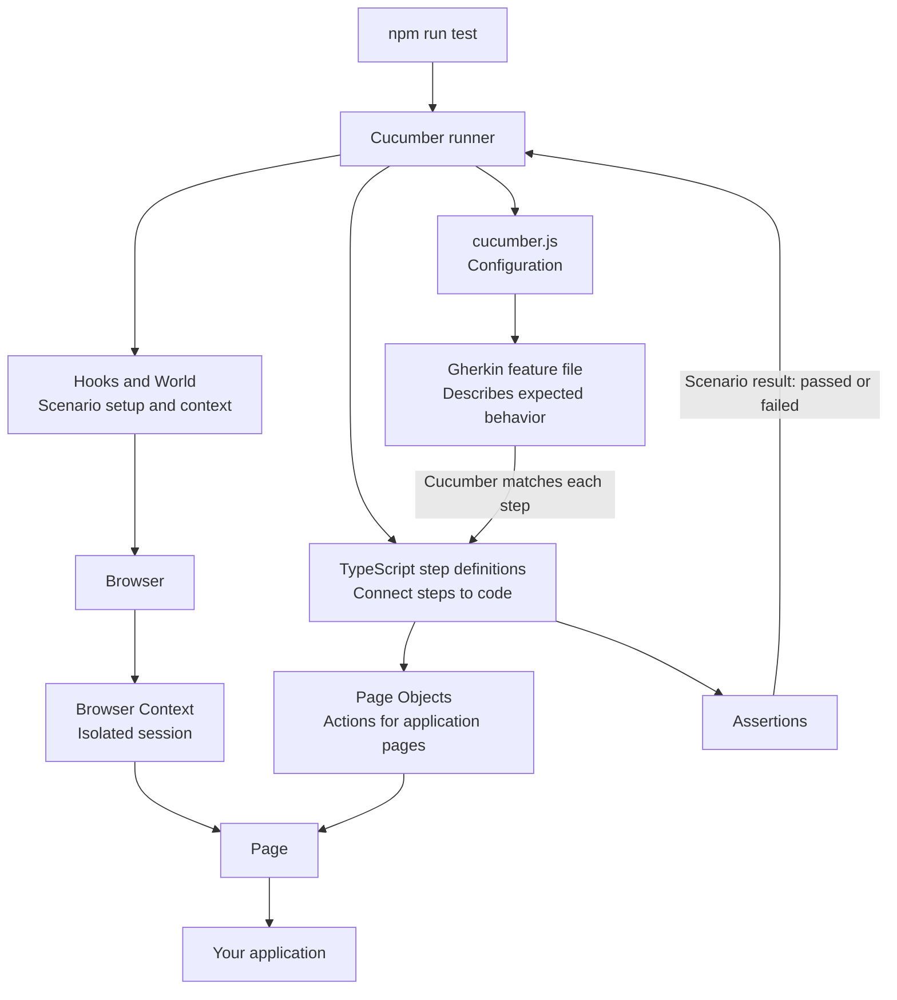

# BDD Test Automation Architecture: Cucumber, Gherkin, Playwright, and TypeScript

## How to read the diagram

- **Gherkin feature file** describes expected behavior in readable language.
- **Cucumber** runs scenarios and matches each Gherkin step to a TypeScript step definition.
- **Step definitions** connect those steps to test code.
- **Hooks and World** prepare and hold the context for a scenario. For example, a `Before` hook can create a page, and an `After` hook can close it.
- **Page Objects** collect the locators and actions for application pages.
- **Playwright** controls the browser through `Browser`, `Browser Context`, and `Page`.
- **Assertions** check whether the application behaved as expected.

In this architecture, **Cucumber is the test runner**, and **Playwright controls the browser**. We are not using the Playwright Test runner; each tool has a separate responsibility.